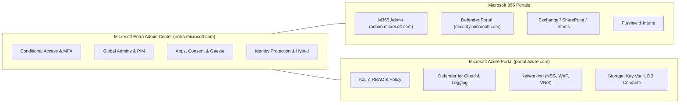

# Microsoft Azure & Microsoft 365 Security Assessment – Konfigurationsanalyse (CIS Benchmarks)

Umfassender Praxis-Leitfaden zur Durchführung einer **Microsoft Azure & Microsoft 365 Konfigurationsanalyse** mit den Read-Only-Rollen **Global Reader** und **Security Reader**, orientiert an den aktuellen **CIS Benchmarks** und optimiert für **Linux-CLI (`az`, `az rest`, `m365`, `jq`, `dig`) als Hauptwerkzeug**:

- **CIS Microsoft 365 Foundations Benchmark** *(v5.x / v6.x / v7.x)*
- **CIS Microsoft Azure Foundations Benchmark** *(v5.x / v6.x)*
- Ergänzend: **CIS Azure Compute, Database & Storage Services Benchmarks**

Jeder Prüfpunkt ist konsequent aufgebaut nach:
1. **Erklärung & Risiko** *(Warum prüfen wir das?)*
2. **Soll-Zustand nach CIS Benchmark** *(Level 1 vs. Level 2)*
3. **Prüfungsort** *(Microsoft Entra Admin Center vs. Azure Portal vs. M365 / Defender / Purview / Exchange / SharePoint / Teams / Intune / Fabric)*
4. **Prüfung über die UI** *(exakter Klickpfad)*
5. **Prüfung über Linux CLI** *(primär `az` / `az rest` / `m365` / `jq` / `dig`; nur wo Microsoft keine REST-API bietet via nativem Linux-`pwsh`)*
6. **Rollen- & Berechtigungshinweise** *(Was geht mit `Global Reader` + `Security Reader`, und wo greifen harte Microsoft-Grenzen bzw. Workarounds?)*

---

## Schnellübersicht: Kapitelstruktur

| Kapitel | Thema | Primäres Portal | Primäre Linux CLI |
| :---: | :--- | :--- | :--- |
| **01** | [Vorbereitung, Rollenmodell, Berechtigungsgrenzen & Linux-CLI-Tooling](docs/01-vorbereitung-rollen-und-tools.md) | Alle Portale | `az`, `m365`, `jq`, `dig` (+ optional `pwsh`) |
| **02** | [Microsoft Entra ID – Identitäten, Authentifizierung & Zugriffskontrolle](docs/02-entra-id-identitaeten-und-zugriff.md) | **Entra Admin Center** (`entra.microsoft.com`) | 100 % `az rest` / `m365` + `jq` |
| **03** | [Microsoft 365 Admin Center – Tenant-Grundlagen & Governance](docs/03-m365-admin-center-und-governance.md) | **M365 Admin Center** (`admin.microsoft.com`) | `az rest` / `m365` + `jq` *(Lockbox/Calendar via `pwsh`)* |
| **04** | [E-Mail-Sicherheit – Exchange Online & Defender for Office 365](docs/04-exchange-online-und-defender-for-office365.md) | **Exchange Admin** & **Defender Portal** (`security.microsoft.com`) | DNS & Secure Score: `dig` + `az rest` / EXO & MDO: Linux `pwsh` |
| **05** | [Kollaboration – SharePoint, OneDrive, Teams & Fabric/Power BI](docs/05-sharepoint-onedrive-teams-und-fabric.md) | **SharePoint**, **Teams** & **Fabric Admin** | SPO & Fabric: `az rest` / `curl` / Teams Policies: Linux `pwsh` |
| **06** | [Compliance & Endgeräte – Microsoft Purview & Microsoft Intune](docs/06-purview-und-intune.md) | **Purview** (`purview.microsoft.com`) & **Intune** (`intune.microsoft.com`) | Intune & Labels: 100 % `az rest` / `m365` / DLP: Linux `pwsh` |
| **07** | [Azure Governance, RBAC, Policy, Logging & Defender for Cloud](docs/07-azure-governance-rbac-und-defender-for-cloud.md) | **Azure Portal** (`portal.azure.com`) | 100 % `az` + `az graph query` + `az rest` |
| **08** | [Azure Netzwerksicherheit (NSGs, Public IPs, Bastion, Flow Logs, WAF)](docs/08-azure-netzwerk-sicherheit.md) | **Azure Portal** (`portal.azure.com`) | 100 % `az` + `az graph query` |
| **09** | [Azure Storage, Key Vault & Datenbank-Sicherheit (SQL, PG, Cosmos)](docs/09-azure-storage-keyvault-und-datenbanken.md) | **Azure Portal** (`portal.azure.com`) | 100 % `az` + `az graph query` |
| **10** | [Azure Compute (VMs), App Service, Container (AKS/ACR) & Analytics](docs/10-azure-compute-appservice-und-container.md) | **Azure Portal** (`portal.azure.com`) | 100 % `az` + `az graph query` |
| **11** | [Automatisierung, Linux-CLI-Tools & Resource Graph (KQL)](docs/11-automatisierte-pruefskripte-und-tools.md) | Linux Terminal / Resource Graph | Prowler, ScoutSuite, ROADrecon, `m365`, Maester |
| **12** | [Bewertung, Reporting, Finding-Template & Master-Checkliste](docs/12-bewertung-reporting-und-checkliste.md) | Berichtswesen | Risikomatrix, Finding-Template, Abhakliste |

---

## Auf einen Blick: Entra ID vs. Azure vs. M365 Portale

---

## Wichtige Besonderheiten bei `Global Reader` + `Security Reader` & Linux CLI

Vor Beginn jedes Assessments unbedingt beachten (Details in [Kapitel 1](docs/01-vorbereitung-rollen-und-tools.md)):

1. **`Security Reader` existiert zweimal:**
   - **Entra ID `Security Reader`** → liest Microsoft Defender Portal (inkl. Secure Score), Identity Protection & PIM.
   - **Azure RBAC `Security Reader`** (auf Management Group / Subscription) → liest Defender for Cloud (Secure Score, CIS Compliance, Assessments), Azure RBAC, Azure Policy, Log Analytics und Alert Rules.
2. **Azure RBAC `Security Reader` enthält KEIN `*/read`:**
   - Direkte Ressourcen-Abfragen wie `az storage account list`, `az network nsg list` oder `az keyvault list` erfordern zusätzlich Azure RBAC **`Reader`** auf der Subscription / Management Group.
   - **Workaround ohne `Reader`:** Alle Kapitel 8–10 enthalten fertige **Defender for Cloud / Azure Resource Graph (`securityresources`)** Queries, die mit reinem `Security Reader` unter Linux funktionieren!
3. **Linux CLI & Microsoft Graph (`az rest` vs. `m365`):**
   - `az rest --url "https://graph.microsoft.com/..."` funktioniert für viele Entra-/M365-Endpunkte nativ unter Linux.
   - Da Microsoft die Azure-CLI-App nicht für alle Graph-Scopes vorautorisiert hat (`Policy.Read.All`, `Reports.Read.All`, `DeviceManagementConfiguration.Read.All`), kann bei `403 AccessDenied` nahtlos **CLI for Microsoft 365 (`m365 request`)** unter Linux verwendet werden.
4. **Exchange Online, Defender for O365, Teams Policies & Purview DLP unter Linux:**
   - Microsoft bietet hierfür keine öffentliche Graph-REST-API. Die offiziellen Module `ExchangeOnlineManagement` (v3 REST) und `MicrosoftTeams` laufen jedoch **nativ unter Linux über `pwsh` (PowerShell 7)** (inkl. `-Device` Login für SSH/Headless-Terminals).

---

## Mitgelieferte Read-Only-Skripte (`scripts/`)

Alle Skripte im Ordner [`scripts/`](scripts/) führen **ausschließlich schreibgeschützte Lese-Operationen** durch und laufen nativ unter Linux:

| Datei | Beschreibung | Aufruf (Linux) |
| :--- | :--- | :--- |
| [`scripts/audit-azure-security-reader.sh`](scripts/audit-azure-security-reader.sh) | **100 % Linux Bash + `az` CLI** Collector für alle Azure Subscriptions (erkennt automatisch `Security Reader` vs. `Reader`) | `az login --tenant <TID> && ./scripts/audit-azure-security-reader.sh` |
| [`scripts/audit-m365-entra-linux.sh`](scripts/audit-m365-entra-linux.sh) | **100 % Linux Bash + `az rest`/`m365` + `jq` + `dig`** Collector für Entra ID, M365, DNS (SPF/DKIM/DMARC), SharePoint, Intune & Secure Score *(optional `--with-pwsh` für EXO/Teams)* | `./scripts/audit-m365-entra-linux.sh --tool m365` |
| [`scripts/audit-m365-entra-reader.ps1`](scripts/audit-m365-entra-reader.ps1) | Linux-kompatibles `pwsh`-Skript für Exchange Online, Defender for O365, Teams Policies & optional Purview (`-IncludePurview`, `-UseDeviceAuth`, `-SkipGraph`) | `pwsh ./scripts/audit-m365-entra-reader.ps1 -TenantId <TID> -UserPrincipalName <UPN> -UseDeviceAuth` |
| [`scripts/kql-resource-graph-queries.kql`](scripts/kql-resource-graph-queries.kql) | Fertige Azure Resource Graph KQL-Abfragen (getrennt nach `Security Reader` und `Reader`) | Direkt via `az graph query -q "..."` oder im Azure Portal |

---

## Empfohlener Assessment-Ablauf (Linux)

1. **Kick-off & Rollen-Check ([Kapitel 1](docs/01-vorbereitung-rollen-und-tools.md)):** Eigene Rollen, Lizenzen, Domains & Hybrid-Status per `az rest` prüfen; klären ob Azure `Reader` zusätzlich gewährt wird.
2. **Automatisierte Datensammlung ([Kapitel 11](docs/11-automatisierte-pruefskripte-und-tools.md)):** `./scripts/audit-m365-entra-linux.sh` + `./scripts/audit-azure-security-reader.sh` (und optional *Prowler* / *ScoutSuite* / *ROADrecon*) ausführen.
3. **Tiefenprüfung nach Priorität:**
   - Identitäten & Zugriff ([Kapitel 2](docs/02-entra-id-identitaeten-und-zugriff.md))
   - E-Mail & Defender for Office 365 ([Kapitel 4](docs/04-exchange-online-und-defender-for-office365.md))
   - M365 Admin, SharePoint, Teams, Fabric, Purview & Intune ([Kapitel 3](docs/03-m365-admin-center-und-governance.md), [5](docs/05-sharepoint-onedrive-teams-und-fabric.md), [6](docs/06-purview-und-intune.md))
   - Azure Governance, Defender for Cloud, Netzwerk, Storage, Key Vault, DBs & Compute ([Kapitel 7–10](docs/07-azure-governance-rbac-und-defender-for-cloud.md))
4. **Konsolidierung & Reporting ([Kapitel 12](docs/12-bewertung-reporting-und-checkliste.md)):** Findings anhand der Risikomatrix priorisieren, Master-Checkliste vervollständigen und Kundenbericht erstellen.