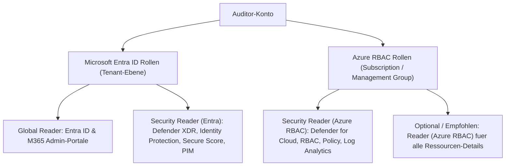

# Kapitel 1: Vorbereitung, Rollenmodell, Berechtigungsgrenzen & Tooling

Dieses Kapitel legt die methodische und technische Grundlage für eine **Microsoft Azure & Microsoft 365 Konfigurationsanalyse (Security Assessment)** auf Basis der **CIS Benchmarks**, wenn der Auditor die Rollen **Global Reader** und **Security Reader** erhält.

---

## 1.1 Orientierung an den CIS Benchmarks

Die Konfigurationsanalyse orientiert sich an den aktuellen **Center for Internet Security (CIS) Benchmarks**:

| Benchmark | Fokus | Relevante Domänen |
| :--- | :--- | :--- |
| **CIS Microsoft 365 Foundations Benchmark** *(v5.x / v6.x / v7.x)* | M365-Workloads & Microsoft Entra ID | Sec. 1 M365 Admin, Sec. 2 Defender for O365, Sec. 3 Purview, Sec. 4 Intune, Sec. 5 Entra ID, Sec. 6 Exchange Online, Sec. 7 SharePoint/OneDrive, Sec. 8 Teams, Sec. 9 Fabric/Power BI |
| **CIS Microsoft Azure Foundations Benchmark** *(v5.x / v6.x)* | Azure-Plattform & Infrastruktur | Analytics, Compute, Identity (Azure RBAC), Management & Governance (Logging/Policy), Networking, Security (Defender for Cloud & Key Vault), Storage |
| **CIS Azure Compute / Database / Storage Benchmarks** *(ergänzend)* | Tiefenprüfung von Workloads | VMs, App Service, AKS/ACR, Azure SQL, PostgreSQL, MySQL, Cosmos DB, Storage Accounts |

> [!NOTE]
> **CIS Profile Levels richtig einordnen:**
> - **Level 1 (L1):** Praktische, sofort umsetzbare Sicherheits-Basiskonfiguration ohne wesentliche Einschränkung der Produktivität. Abweichungen von L1 sind im Assessment fast immer klare **Findings**.
> - **Level 2 (L2):** Defense-in-Depth für Umgebungen mit erhöhtem Schutzbedarf (kann betrieblichen Aufwand oder Komforteinschränkungen bedeuten). Abweichungen werden kontextabhängig bewertet.
> - **E3 vs. E5 (M365):** Einige CIS-M365-Kontrollen erfordern Entra ID P2, Defender for Office 365 Plan 1/2 oder Microsoft Purview (E5/Compliance-Add-on). Prüfe zu Beginn unbedingt den **Lizenzstand des Tenants**, damit fehlende Features korrekt als *Lizenzlücke / Architektur-Empfehlung* und nicht als reine Fehlkonfiguration bewertet werden.

---

## 1.2 Das Rollenmodell: Entra ID vs. Azure RBAC (WICHTIG!)

In der Praxis entsteht bei Assessments ein klassisches Missverständnis: Die Rolle **Security Reader** existiert **zweimal** – einmal in **Microsoft Entra ID** (Tenant-Ebene) und einmal in **Azure RBAC** (Management-Group-/Subscription-Ebene).



### Kritische Berechtigungsgrenzen von `Global Reader` + `Security Reader`

| Bereich / Aufgabe | Entra `Global Reader` | Entra `Security Reader` | Azure RBAC `Security Reader` | Azure RBAC `Reader` *(optional)* | Praxis-Hinweis / Workaround |
| :--- | :---: | :---: | :---: | :---: | :--- |
| **Entra ID** (CA, Rollen, Apps, Users, Auth Methods) | ✅ Vollständig | ⚠️ Teilweise (Security) | ❌ | ❌ | `Global Reader` deckt fast alles ab |
| **Microsoft Defender Portal** (Secure Score, Defender for O365) | ⚠️ Eingeschränkt *(kein Secure Score / Content Search)* | ✅ Vollständig (Read-Only) | ❌ | ❌ | **Kombination beider Rollen notwendig!** |
| **M365 Admin Center** | ✅ Vollständig *(ohne Billing/Purchase)* | ❌ | ❌ | ❌ | Über `Global Reader` |
| **Exchange Online** (UI & EXO PowerShell) | ✅ Vollständig (Read-Only) | ⚠️ Security-Cmdlets | ❌ | ❌ | `Connect-ExchangeOnline` funktioniert mit `Global Reader` |
| **SharePoint Online** (UI vs. PowerShell) | ✅ UI & Graph API / ❌ `Get-SPOTenant` | ❌ | ❌ | ❌ | **Stolperfalle:** `Get-SPOTenant` braucht SharePoint Admin → stattdessen **UI** oder **Graph API** nutzen! |
| **Microsoft Teams** (UI & Teams PowerShell) | ✅ Fast alles *(ohne App-Katalog/Analytics)* | ❌ | ❌ | ❌ | Alle sicherheitsrelevanten Policies lesbar |
| **Microsoft Purview** (Audit, DLP, Labels) | ⚠️ Eingeschränkt *(UI teils limitiert)* | ✅ Security & Compliance Read | ❌ | ❌ | `Connect-IPPSSession` mit `Security Reader` + `Global Reader` testen; ggf. *Compliance Data/View-Only* prüfen |
| **Microsoft Intune** (Compliance, Enrollment) | ✅ Read-Only | ⚠️ Endpoint Security | ❌ | ❌ | In `intune.microsoft.com` und via Graph lesbar |
| **Microsoft Fabric / Power BI** | ⚠️ Teilweise | ❌ | ❌ | ❌ | Tenant-Settings erfordern oft **Fabric Administrator** → im Zweifel über Screenshot/Interview mit Kunden prüfen |
| **Azure Defender for Cloud** (Secure Score, CIS Compliance, Assessments) | ❌ | ❌ | ✅ Vollständig | ✅ | Funktioniert direkt mit Azure `Security Reader` |
| **Azure RBAC, Azure Policy, Management Groups, Log Analytics** | ❌ | ❌ | ✅ Vollständig | ✅ | Durch `Microsoft.Authorization/*/read` & `Microsoft.operationalInsights/workspaces/*/read` gedeckt |
| **Azure Ressourcen-Details** (`az storage`, `az network nsg`, `az sql`, `az keyvault`, `az vm`, `az webapp`) | ❌ | ❌ | ❌ *(nur indirekt via Defender Assessments!)* | ✅ Vollständig (`*/read`) | **Sehr wichtig:** Azure `Security Reader` hat **kein** `*/read`! Ohne Azure `Reader` sind Detailprüfungen nur über Defender-Assessments (`securityresources`) möglich. |
| **Key Vault Objekte** (Ablaufdaten von Keys/Secrets/Zertifikaten) | ❌ | ❌ | ❌ | ❌ *(nur Vault-Config)* | Erfordert zusätzlich `Key Vault Reader` (bei RBAC-Vaults) bzw. Access Policy `List`. |

> [!IMPORTANT]
> **Praxis-Tipp für das Kick-off mit dem Kunden:**
> Wenn du im Assessment **auch die Azure-Infrastruktur (Storage, Netzwerke/NSGs, SQL, VMs, App Services, Key Vaults)** direkt per CLI/UI gegen den CIS Azure Foundations Benchmark prüfen sollst, fordere neben **Global Reader** (Entra) und **Security Reader** (Entra + Azure) zusätzlich die Rolle **Reader** auf **Tenant Root Group** (oder allen relevanten Subscriptions) an!
> Falls der Kunde strikt nur **Security Reader** in Azure gewährt, dokumentiert dieser Leitfaden in den Kapiteln 7–10 sowohl den **direkten Weg (mit `Reader`)** als auch den **Workaround über Microsoft Defender for Cloud Assessments (`securityresources`)**, der mit reinem `Security Reader` funktioniert.

---

## 1.3 Portal-Landkarte: Wo prüfe ich was?

Ein häufiges Problem bei Microsoft-Cloud-Assessments ist die Vielzahl an Admin-Portalen. Diese Tabelle ordnet jedes Prüffeld eindeutig zu:

| Prüfbereich | Primäres Portal | URL | Alternative / Hinweis |
| :--- | :--- | :--- | :--- |
| **Identitäten, MFA, Conditional Access, PIM, Apps, Gäste** | **Microsoft Entra Admin Center** | `https://entra.microsoft.com` | Auch im Azure Portal unter *Microsoft Entra ID*, aber Entra Admin Center ist der aktuelle Standard |
| **M365 Tenant-Settings, Lizenzen, Gruppen, Shared Mailboxes** | **Microsoft 365 Admin Center** | `https://admin.microsoft.com` | – |
| **E-Mail-Schutz (Defender for O365), Secure Score, Incidents, MDCA** | **Microsoft Defender Portal** | `https://security.microsoft.com` | Früher „M365 Defender“; enthält auch Defender for Endpoint & Identity |
| **Mailflow, Transport Rules, DKIM, Remote Domains, SMTP AUTH** | **Exchange Admin Center (EAC)** | `https://admin.exchange.microsoft.com` | DNS (SPF/DMARC) zusätzlich extern per `dig`/`nslookup` prüfen |
| **SharePoint & OneDrive Sharing, Sync, Access Control** | **SharePoint Admin Center** | `https://<tenant>-admin.sharepoint.com` | Erreichbar über M365 Admin Center → *Admin centers → SharePoint* |
| **Teams Federation, Meetings, Apps, External Access** | **Microsoft Teams Admin Center** | `https://admin.teams.microsoft.com` | – |
| **Audit Log, DLP, Sensitivity Labels, Retention** | **Microsoft Purview Portal** | `https://purview.microsoft.com` | Neues einheitliches Purview-Portal |
| **Geräte-Compliance, Enrollment, App Protection** | **Microsoft Intune Admin Center** | `https://intune.microsoft.com` | – |
| **Power BI / Fabric Tenant-Sicherheit** | **Microsoft Fabric Admin Portal** | `https://app.powerbi.com/admin-portal` | Oft nur mit Fabric Admin einsehbar |
| **Azure Subscriptions, RBAC, Policy, Defender for Cloud, Netzwerk, Storage, Key Vault, DB, Compute** | **Microsoft Azure Portal** | `https://portal.azure.com` | Alle IaaS/PaaS-Ressourcen & Defender for Cloud |

---

## 1.4 Einrichtung der CLI- & PowerShell-Umgebung

Für ein effizientes, reproduzierbares Assessment werden **Azure CLI** (Linux/macOS/Windows) und **PowerShell 7** mit den offiziellen Microsoft-Modulen benötigt.

### 1.4.1 Azure CLI & Erweiterungen installieren

```bash
# Version prüfen
az version

# Benötigte Extensions für Security Assessments installieren
az extension add --name resource-graph
az extension add --name security
az extension add --name account
az extension add --name aks-preview   # optional für AKS-Details

# Interaktive Anmeldung (Tenant-ID explizit angeben, besonders bei Gast-Konten!)
az login --tenant "<TENANT_ID>"

# Falls der Account keine Azure-Subscriptions sieht (nur Entra-Rechte):
az login --tenant "<TENANT_ID>" --allow-no-subscriptions

# Alle sichtbaren Subscriptions anzeigen
az account list --output table

# Eigene effektive Berechtigungen auf der aktiven Subscription prüfen
az role assignment list --assignee "$(az ad signed-in-user show --query id -o tsv)" --all --output table
```

### 1.4.2 PowerShell 7 & Microsoft-Module installieren

```powershell
# PowerShell 7 prüfen
$PSVersionTable.PSVersion

# Benötigte Module für M365, Entra ID & Azure installieren (CurrentUser)
$modules = @(
    "Microsoft.Graph.Authentication",
    "Microsoft.Graph.Identity.DirectoryManagement",
    "Microsoft.Graph.Identity.SignIns",
    "Microsoft.Graph.Identity.Governance",
    "Microsoft.Graph.Users",
    "Microsoft.Graph.Groups",
    "Microsoft.Graph.Applications",
    "Microsoft.Graph.Security",
    "Microsoft.Graph.Reports",
    "Microsoft.Graph.DeviceManagement",
    "Microsoft.Graph.Beta.Identity.DirectoryManagement",
    "Microsoft.Graph.Beta.Security",
    "ExchangeOnlineManagement",
    "MicrosoftTeams",
    "Az.Accounts",
    "Az.Resources",
    "Az.ResourceGraph",
    "Az.Security"
)

foreach ($mod in $modules) {
    Install-Module -Name $mod -Scope CurrentUser -Force -AllowClobber
}
```

### 1.4.3 Read-Only-Verbindungen herstellen

```powershell
# 1. Microsoft Graph (nur Read-Only-Scopes anfordern!)
$ReadOnlyScopes = @(
    "Directory.Read.All",
    "Policy.Read.All",
    "Policy.Read.ConditionalAccess",
    "RoleManagement.Read.All",
    "RoleManagement.Read.Directory",
    "AuditLog.Read.All",
    "Reports.Read.All",
    "SecurityEvents.Read.All",
    "IdentityRiskyUser.Read.All",
    "IdentityRiskEvent.Read.All",
    "Application.Read.All",
    "UserAuthenticationMethod.Read.All",
    "DeviceManagementConfiguration.Read.All",
    "DeviceManagementManagedDevices.Read.All",
    "SharePointTenantSettings.Read.All",
    "Organization.Read.All"
)
Connect-MgGraph -TenantId "<TENANT_ID>" -Scopes $ReadOnlyScopes

# Prüfen, welche Scopes tatsächlich gewährt wurden:
(Get-MgContext).Scopes

# 2. Exchange Online PowerShell
Connect-ExchangeOnline -UserPrincipalName "auditor@kunde.de" -ShowBanner:$false

# 3. Security & Compliance (Microsoft Purview) PowerShell
Connect-IPPSSession -UserPrincipalName "auditor@kunde.de"

# 4. Microsoft Teams PowerShell
Connect-MicrosoftTeams -TenantId "<TENANT_ID>"

# 5. Azure PowerShell (optional parallel zu az cli)
Connect-AzAccount -Tenant "<TENANT_ID>"
```

> [!WARNING]
> **Hinweis zu Graph-Scopes & Admin Consent:**
> Wenn im Kunden-Tenant **User Consent für Apps deaktiviert** ist (was nach CIS sogar erwünscht ist!), kannst du beim ersten `Connect-MgGraph` möglicherweise keinen eigenen Consent für die *Microsoft Graph Command Line Tools* App erteilen.
> **Lösung:**
> 1. Den Kunden bitten, einmalig Admin Consent für die Read-Only-Scopes der App `14d82eec-204b-4c2f-b7e8-296a70dab67e` (*Microsoft Graph Command Line Tools*) zu erteilen – **oder** eine dedizierte Read-Only Assessment App Registration nutzen.
> 2. Alternativ funktionieren `az rest` (über die oft bereits freigegebene Azure CLI App) und die **Admin-Portale (UI)** sofort ohne zusätzlichen Graph-Consent!

---

## 1.5 Pre-Assessment Quick-Check (Erste 10 Minuten)

Bevor du in die Einzelkapitel einsteigst, prüfe diese 5 Punkte zur Orientierung:

1. **Eigene Rollen verifizieren:**
   - Entra Portal → *Identity → Roles & admins → Assigned roles* (oder Klick auf Profil → *My roles*).
   - Azure Portal → *Subscriptions* → prüfen, welche Subscriptions sichtbar sind und welche Rolle dort greift (*Access control (IAM) → View my access*).
2. **Lizenzstand erfassen (Entra / M365):**
   - `Get-MgSubscribedSku | Select-Object SkuPartNumber, ConsumedUnits, @{N='Enabled';E={$_.PrepaidUnits.Enabled}}`
   - Wichtige Frage: Hat der Kunde **Entra ID P1/P2** (für Conditional Access / PIM / Identity Protection), **M365 E3/E5** oder **Business Premium**?
3. **Hybrid vs. Cloud-Only klären:**
   - `Get-MgOrganization | Select-Object DisplayName, OnPremisesSyncEnabled, OnPremisesLastSyncDateTime`
   - Bei Hybrid-Umgebungen (Entra Connect) gelten zusätzliche Prüfpunkte (z. B. keine gesyncten Admins, Password Hash Sync, Smart Lockout, AD FS / Seamless SSO).
4. **Domain-Inventar ziehen:**
   - `Get-MgDomain | Select-Object Id, IsVerified, IsDefault, AuthenticationType`
   - Alle verifizierten Domains notieren → relevant für SPF/DKIM/DMARC-Prüfungen in Kapitel 4!
5. **Evidenz-Ordner lokal anlegen:**
   - Strukturierte Ablage nach Kapiteln (`evidence/02-entra/`, `evidence/04-exchange/`, `evidence/07-azure-governance/` etc.) für Screenshots, JSON-Exports und CSVs.
