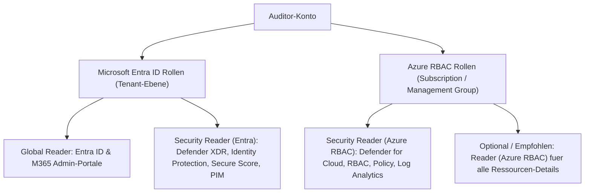

# Kapitel 1: Vorbereitung, Rollenmodell, Berechtigungsgrenzen & Linux-CLI-Tooling

Dieses Kapitel legt die methodische und technische Grundlage für eine **Microsoft Azure & Microsoft 365 Konfigurationsanalyse (Security Assessment)** auf Basis der **CIS Benchmarks** – optimiert für **Linux-CLI als Hauptwerkzeug** mit den Rollen **Global Reader** und **Security Reader**.

---

## 1.1 Orientierung an den CIS Benchmarks

Die Konfigurationsanalyse orientiert sich an den aktuellen **Center for Internet Security (CIS) Benchmarks**:

| Benchmark | Fokus | Relevante Domänen |
| :--- | :--- | :--- |
| **CIS Microsoft 365 Foundations Benchmark** *(v5.x / v6.x / v7.x)* | M365-Workloads & Microsoft Entra ID | Sec. 1 M365 Admin, Sec. 2 Defender for O365, Sec. 3 Purview, Sec. 4 Intune, Sec. 5 Entra ID, Sec. 6 Exchange Online, Sec. 7 SharePoint/OneDrive, Sec. 8 Teams, Sec. 9 Fabric/Power BI |
| **CIS Microsoft Azure Foundations Benchmark** *(v5.x / v6.x)* | Azure-Plattform & Infrastruktur | Analytics, Compute, Identity (Azure RBAC), Management & Governance (Logging/Policy), Networking, Security (Defender for Cloud & Key Vault), Storage |
| **CIS Azure Compute / Database / Storage Benchmarks** *(ergänzend)* | Tiefenprüfung von Workloads | VMs, App Service, AKS/ACR, Azure SQL, PostgreSQL, MySQL, Cosmos DB, Storage Accounts |

> [!NOTE]
> **CIS Profile Levels richtig einordnen:**
> - **Level 1 (L1):** Praktische, sofort umsetzbare Sicherheits-Basiskonfiguration ohne wesentliche Einschränkung der Produktivität. Abweichungen von L1 sind im Assessment fast immer klare **Findings**.
> - **Level 2 (L2):** Defense-in-Depth für Umgebungen mit erhöhtem Schutzbedarf (kann betrieblichen Aufwand oder Komforteinschränkungen bedeuten). Abweichungen werden kontextabhängig bewertet.
> - **E3 vs. E5 (M365):** Einige CIS-M365-Kontrollen erfordern Entra ID P2, Defender for Office 365 Plan 1/2 oder Microsoft Purview (E5/Compliance-Add-on). Prüfe zu Beginn unbedingt den **Lizenzstand des Tenants**, damit fehlende Features korrekt als *Lizenzlücke / Architektur-Empfehlung* bewertet werden.

---

## 1.2 Das Rollenmodell: Entra ID vs. Azure RBAC (WICHTIG!)

In der Praxis entsteht bei Assessments ein klassisches Missverständnis: Die Rolle **Security Reader** existiert **zweimal** – einmal in **Microsoft Entra ID** (Tenant-Ebene) und einmal in **Azure RBAC** (Management-Group-/Subscription-Ebene).



### Kritische Berechtigungsgrenzen von `Global Reader` + `Security Reader`

| Bereich / Aufgabe | Entra `Global Reader` | Entra `Security Reader` | Azure RBAC `Security Reader` | Azure RBAC `Reader` *(optional)* | Praxis-Hinweis / Workaround |
| :--- | :---: | :---: | :---: | :---: | :--- |
| **Entra ID** (CA, Rollen, Apps, Users, Auth Methods) | ✅ Vollständig | ⚠️ Teilweise (Security) | ❌ | ❌ | `Global Reader` deckt fast alles ab |
| **Microsoft Defender Portal** (Secure Score, Defender for O365) | ⚠️ Eingeschränkt *(kein Secure Score / Content Search)* | ✅ Vollständig (Read-Only) | ❌ | ❌ | **Kombination beider Rollen notwendig!** |
| **M365 Admin Center** | ✅ Vollständig *(ohne Billing/Purchase)* | ❌ | ❌ | ❌ | Über `Global Reader` |
| **Exchange Online** (UI & EXO CLI via `pwsh`) | ✅ Vollständig (Read-Only) | ⚠️ Security-Cmdlets | ❌ | ❌ | `Connect-ExchangeOnline` läuft mit `Global Reader` auch unter Linux |
| **SharePoint Online** (UI & Graph API vs. SPO PS) | ✅ UI & Graph API / ❌ `Get-SPOTenant` | ❌ | ❌ | ❌ | **Stolperfalle:** `Get-SPOTenant` braucht SharePoint Admin → stattdessen **UI** oder **Graph REST API (`/v1.0/admin/sharepoint/settings`)** nutzen! |
| **Microsoft Teams** (UI & Teams CLI via `pwsh`) | ✅ Fast alles *(ohne App-Katalog/Analytics)* | ❌ | ❌ | ❌ | Alle sicherheitsrelevanten Policies lesbar |
| **Microsoft Purview** (Audit, DLP, Labels) | ⚠️ Eingeschränkt *(UI teils limitiert)* | ✅ Security & Compliance Read | ❌ | ❌ | `Connect-IPPSSession` mit `Security Reader` + `Global Reader` testen |
| **Microsoft Intune** (Compliance, Enrollment) | ✅ Read-Only | ⚠️ Endpoint Security | ❌ | ❌ | In `intune.microsoft.com` und via Graph REST API lesbar |
| **Microsoft Fabric / Power BI** | ⚠️ Teilweise | ❌ | ❌ | ❌ | Tenant-Settings erfordern oft **Fabric Administrator** → ggf. per Kunden-Screenshare prüfen |
| **Azure Defender for Cloud** (Secure Score, CIS Compliance, Assessments) | ❌ | ❌ | ✅ Vollständig | ✅ | Funktioniert direkt mit Azure `Security Reader` |
| **Azure RBAC, Azure Policy, Management Groups, Log Analytics** | ❌ | ❌ | ✅ Vollständig | ✅ | Durch `Microsoft.Authorization/*/read` & `Microsoft.operationalInsights/workspaces/*/read` gedeckt |
| **Azure Ressourcen-Details** (`az storage`, `az network nsg`, `az sql`, `az keyvault`, `az vm`, `az webapp`) | ❌ | ❌ | ❌ *(nur indirekt via Defender Assessments!)* | ✅ Vollständig (`*/read`) | **Sehr wichtig:** Azure `Security Reader` hat **kein** `*/read`! Ohne Azure `Reader` sind Detailprüfungen nur über Defender-Assessments (`securityresources`) möglich. |
| **Key Vault Objekte** (Ablaufdaten von Keys/Secrets/Zertifikaten) | ❌ | ❌ | ❌ | ❌ *(nur Vault-Config)* | Erfordert zusätzlich `Key Vault Reader` (bei RBAC-Vaults) bzw. Access Policy `List`. |

> [!IMPORTANT]
> **Praxis-Tipp für das Kick-off mit dem Kunden:**
> Wenn du im Assessment **auch die Azure-Infrastruktur (Storage, Netzwerke/NSGs, SQL, VMs, App Services, Key Vaults)** direkt per CLI/UI gegen den CIS Azure Foundations Benchmark prüfen sollst, fordere neben **Global Reader** (Entra) und **Security Reader** (Entra + Azure) zusätzlich die Rolle **Reader** auf **Tenant Root Group** (oder allen relevanten Subscriptions) an!

---

## 1.3 Portal-Landkarte: Wo prüfe ich was?

| Prüfbereich | Primäres Portal | URL | Alternative / Hinweis |
| :--- | :--- | :--- | :--- |
| **Identitäten, MFA, Conditional Access, PIM, Apps, Gäste** | **Microsoft Entra Admin Center** | `https://entra.microsoft.com` | Auch im Azure Portal unter *Microsoft Entra ID* erreichbar |
| **M365 Tenant-Settings, Lizenzen, Gruppen, Shared Mailboxes** | **Microsoft 365 Admin Center** | `https://admin.microsoft.com` | – |
| **E-Mail-Schutz (Defender for O365), Secure Score, Incidents, MDCA** | **Microsoft Defender Portal** | `https://security.microsoft.com` | Enthält auch Defender for Endpoint & Identity |
| **Mailflow, Transport Rules, DKIM, Remote Domains, SMTP AUTH** | **Exchange Admin Center (EAC)** | `https://admin.exchange.microsoft.com` | DNS (SPF/DMARC) zusätzlich extern per `dig` prüfen |
| **SharePoint & OneDrive Sharing, Sync, Access Control** | **SharePoint Admin Center** | `https://<tenant>-admin.sharepoint.com` | Erreichbar über M365 Admin Center → *Admin centers → SharePoint* |
| **Teams Federation, Meetings, Apps, External Access** | **Microsoft Teams Admin Center** | `https://admin.teams.microsoft.com` | – |
| **Audit Log, DLP, Sensitivity Labels, Retention** | **Microsoft Purview Portal** | `https://purview.microsoft.com` | Neues einheitliches Purview-Portal |
| **Geräte-Compliance, Enrollment, App Protection** | **Microsoft Intune Admin Center** | `https://intune.microsoft.com` | – |
| **Power BI / Fabric Tenant-Sicherheit** | **Microsoft Fabric Admin Portal** | `https://app.powerbi.com/admin-portal` | Oft nur mit Fabric Admin einsehbar |
| **Azure Subscriptions, RBAC, Policy, Defender for Cloud, Netzwerk, Storage, Key Vault, DB, Compute** | **Microsoft Azure Portal** | `https://portal.azure.com` | Alle IaaS/PaaS-Ressourcen & Defender for Cloud |

---

## 1.4 Linux-First CLI-Architektur: Welches Tool wofür?

Dieser Leitfaden nutzt **Linux-CLI (`bash`, `az`, `az rest`, `m365`, `jq`, `dig`) als Hauptwerkzeug**. Wo Microsoft technisch **keine** öffentliche REST-API / native Linux-CLI bereitstellt (Exchange Online, Defender for O365, Teams CS-Policies, Purview DLP), wird **PowerShell 7 (`pwsh`) nativ unter Linux** als leichtgewichtige Ergänzung eingesetzt.

| Ziel-Workload | Primäres Linux-CLI-Tool | Warum? / Besonderheit |
| :--- | :--- | :--- |
| **Microsoft Azure** (Kap. 7–10) | **`az` + `az graph query` + `az rest` + `jq`** | 100 % nativ unter Linux, kein PowerShell nötig. |
| **Microsoft Entra ID, M365 Admin, SharePoint Settings, Intune, Secure Score** (Kap. 2, 3, 5.1, 6.2) | **`az rest`** *(Microsoft Graph)* oder **`m365`** *(CLI for Microsoft 365)* + **`jq`** | 100 % nativ unter Linux. **Hinweis:** Siehe 1.4.2 zu Graph-Scope-Grenzen von `az rest` vs. `m365`! |
| **DNS: SPF, DKIM, DMARC** (Kap. 4.1) | **`dig` + `bash`** | 100 % nativ unter Linux. |
| **Exchange Online, Defender for O365, Teams CS-Policies, Purview DLP** (Kap. 3.5 Lockbox/Calendar, 4.2, 4.3, 5.2, 6.1) | **`pwsh` (PowerShell 7 nativ unter Linux)** *(mit `ExchangeOnlineManagement` v3 REST & `MicrosoftTeams`)* | Microsoft bietet für diese Workloads **keine** öffentliche REST-API / `az`-Subcommands. `pwsh` läuft nativ auf Linux und lässt sich direkt per `pwsh -c "..."` aus Bash aufrufen! |

> [!NOTE]
> **Warum nicht `mgc` (Microsoft Graph CLI)?** Microsoft hat die eigenständige `mgc` CLI im August 2025 abgekündigt (retired). Die robustesten nativen Linux-CLIs für Microsoft Graph sind **`az rest`** und **CLI for Microsoft 365 (`m365`)**.

---

## 1.5 Einrichtung der Linux-CLI-Umgebung

### 1.5.1 Basis-Tools installieren (Ubuntu / Debian)

```bash
# 1. Standard-Tools (jq, dig/dnsutils, curl)
sudo apt-get update && sudo apt-get install -y jq dnsutils curl

# 2. Azure CLI installieren
curl -sL https://aka.ms/InstallAzureCLIDeb | sudo bash

# 3. Azure CLI Extensions für Security Assessments installieren
az extension add --name resource-graph
az extension add --name security
az extension add --name account

# 4. CLI for Microsoft 365 (m365) installieren (Node.js LTS vorausgesetzt)
# Ideal für Microsoft Graph Endpunkte, die über az rest ein 403 liefern!
npm install -g @pnp/cli-microsoft365
```

### 1.5.2 Anmeldung & wichtige Graph-Scope-Besonderheit (`az rest` vs. `m365`)

```bash
# 1. Azure CLI Login (Tenant-ID explizit angeben, insb. bei Gast-Konten!)
az login --tenant "<TENANT_ID>"

# Falls der Account keine Azure-Subscriptions sieht (nur Entra/M365-Rechte):
az login --tenant "<TENANT_ID>" --allow-no-subscriptions

# Alle sichtbaren Subscriptions & eigene Azure RBAC Rollen prüfen
az account list --output table
az role assignment list --assignee "$(az ad signed-in-user show --query id -o tsv)" --all --output table
```

> [!WARNING]
> **Wichtige Linux-Praxis-Falle bei `az rest` gegen Microsoft Graph (`403 Forbidden`):**
> Die First-Party-App der Azure CLI (`04b07795-8ddb-461a-bbee-02f9e1bf7b46`) ist von Microsoft **nicht** für alle privilegierten Graph-Scopes vorautorisiert (insbesondere `Policy.Read.All`, `Reports.Read.All`, `SecurityEvents.Read.All`, `SharePointTenantSettings.Read.All`, `DeviceManagementConfiguration.Read.All`).
> - **Standard-Endpunkte** (`organization`, `domains`, `users`, `groups`, `directoryRoles`, `applications`, `servicePrincipals`, `policies/authorizationPolicy`) funktionieren oft direkt mit `az rest`.
> - **Bei `403 AccessDenied` auf Graph-Endpunkten:** Nutze unter Linux **CLI for Microsoft 365 (`m365`)** mit `m365 request --url "https://graph.microsoft.com/..."`! Jeder `az rest --url "https://graph.microsoft.com/..."` Befehl in diesem Leitfaden lässt sich 1:1 durch `m365 request --url "..." --output json` ersetzen!

```bash
# Optional: CLI for Microsoft 365 Login (interaktiv / Device Code auf Linux)
m365 setup --interactive   # einmalig beim ersten Start (oder eigene Read-Only App Registration)
m365 login --authType deviceCode --tenant "<TENANT_ID>"

# Hilfsfunktion für deine Bash-Session (wähle einmalig GRAPH_CLI=az oder GRAPH_CLI=m365):
graph_get() {
  local url="$1"
  if [[ "${GRAPH_CLI:-az}" == "m365" ]]; then
    m365 request --url "$url" --accept "application/json" --output json
  else
    az rest --method GET --url "$url" -o json
  fi
}
```

### 1.5.3 PowerShell 7 (`pwsh`) nativ auf Linux installieren *(nur für Exchange, Defender O365, Teams & Purview)*

Da Exchange Online, Defender for Office 365, Teams Policies und Purview DLP ausschließlich über Microsofts REST-basierte PowerShell-7-Module erreichbar sind, installierst du `pwsh` sauber direkt auf Linux (funktioniert komplett im Terminal ohne GUI und ohne Windows):

```bash
# Ubuntu 24.04 / Debian (alternativ via Snap: sudo snap install powershell --classic)
source /etc/os-release
wget -q "https://packages.microsoft.com/config/ubuntu/${VERSION_ID}/packages-microsoft-prod.deb"
sudo dpkg -i packages-microsoft-prod.deb && rm -f packages-microsoft-prod.deb
sudo apt-get update && sudo apt-get install -y powershell

# Nur die für Exchange, Defender O365, Purview & Teams wirklich nötigen Module installieren:
pwsh -NoLogo -Command '
  Install-Module -Name ExchangeOnlineManagement -Scope CurrentUser -Force -AllowClobber
  Install-Module -Name MicrosoftTeams -Scope CurrentUser -Force -AllowClobber
'
```

> [!TIP]
> **Headless Linux / SSH-Terminal (ohne lokalen Browser):**
> Nutze beim Login einfach den **Device Code Flow** – das klappt über jede SSH-Session:
> - Azure CLI: `az login --tenant "<TENANT_ID>" --use-device-code`
> - CLI for M365: `m365 login --authType deviceCode --tenant "<TENANT_ID>"`
> - Exchange Online (Linux `pwsh`): `Connect-ExchangeOnline -Device -UserPrincipalName "auditor@kunde.de"`
> - Purview (Linux `pwsh`): `Connect-IPPSSession -Device -UserPrincipalName "auditor@kunde.de"`
> - Teams (Linux `pwsh`): `Connect-MicrosoftTeams -UseDeviceAuthentication -TenantId "<TENANT_ID>"`

---

## 1.6 Pre-Assessment Quick-Check (Erste 10 Minuten – 100 % Linux CLI)

```bash
# 1. Tenant-Info & Hybrid-Sync-Status (Cloud-only vs. Entra Connect!)
az rest --method GET --url "https://graph.microsoft.com/v1.0/organization" \
  --query "value[].{Name:displayName, Id:id, HybridSync:onPremisesSyncEnabled, LastSync:onPremisesLastSyncDateTime}" -o table

# 2. Lizenzstand erfassen (Entra ID P1/P2, M365 E3/E5, Defender Plan 1/2?)
az rest --method GET --url "https://graph.microsoft.com/v1.0/subscribedSkus" \
  --query "value[].{SKU:skuPartNumber, Consumed:consumedUnits, Enabled:prepaidUnits.enabled}" -o table

# 3. Verifizierte Domains & Passwort-Ablaufpolitik (wichtig für Kapitel 3 & 4!)
az rest --method GET --url "https://graph.microsoft.com/v1.0/domains" \
  --query "value[].{Domain:id, Verified:isVerified, Default:isDefault, AuthType:authenticationType, PwdValidDays:passwordValidityPeriodInDays}" -o table

# 4. Eigene Entra ID Rollen verifizieren
az rest --method GET --url "https://graph.microsoft.com/v1.0/me/memberOf" \
  --query "value[?\"@odata.type\"=='#microsoft.graph.directoryRole'].{Role:displayName, Id:id}" -o table

# 5. Evidenz-Ordner lokal anlegen
mkdir -p evidence/{02-entra,03-m365,04-exchange-mdo,05-spo-teams,06-purview-intune,07-azure-gov,08-network,09-storage-kv-db,10-compute}
```
